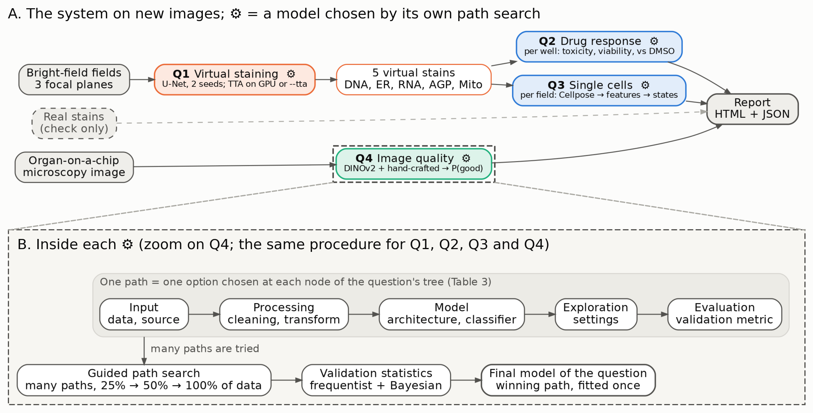
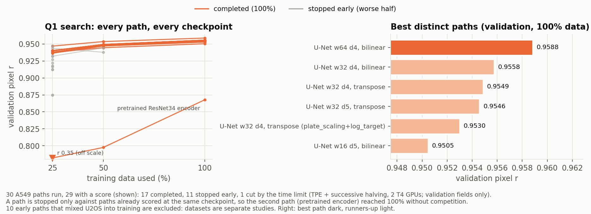
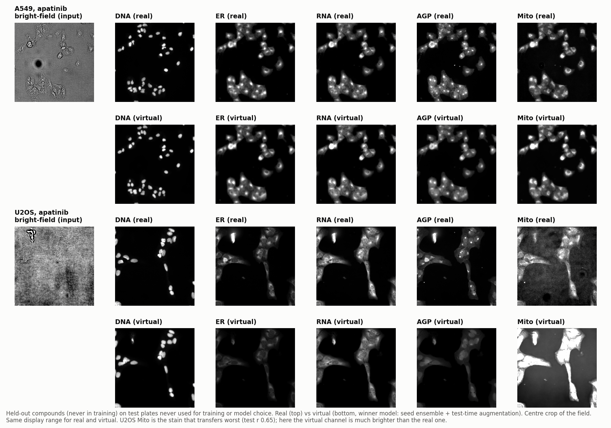
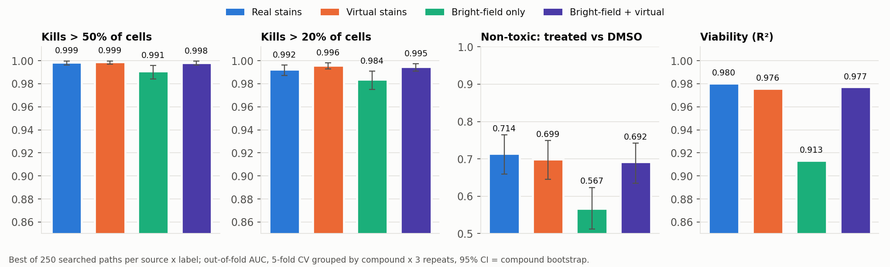
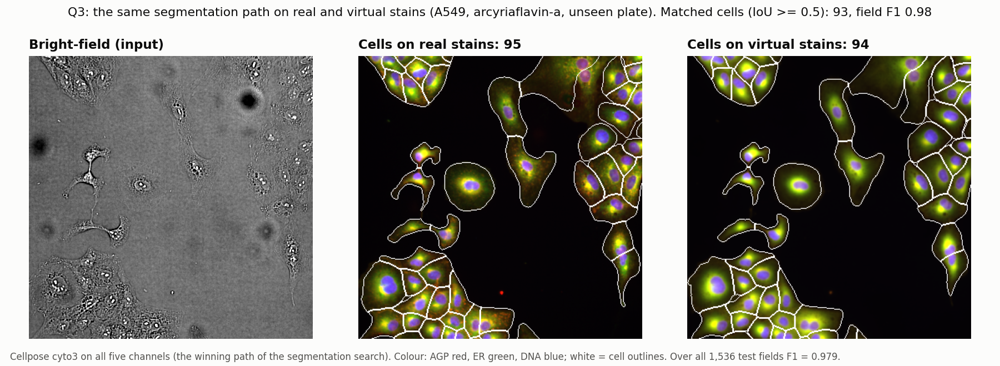
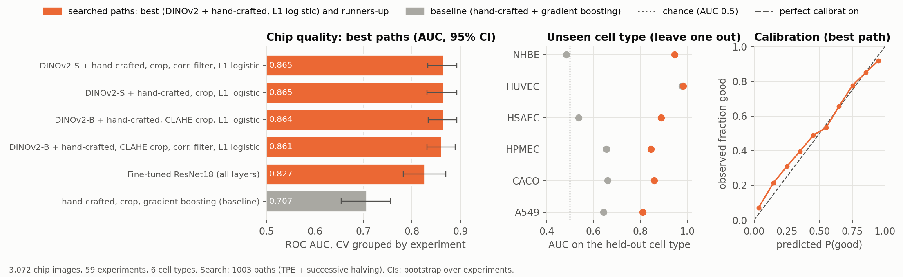
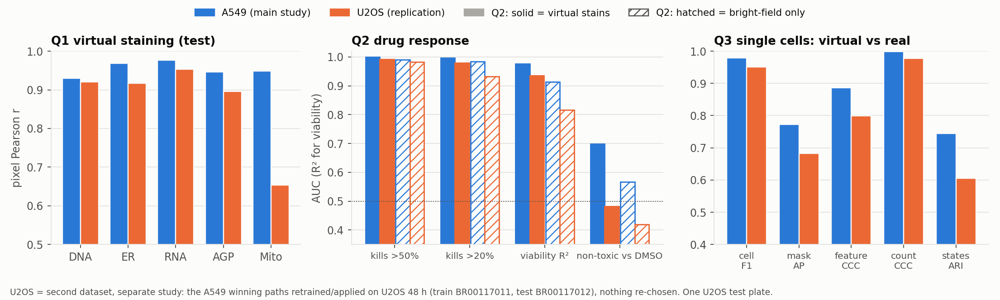
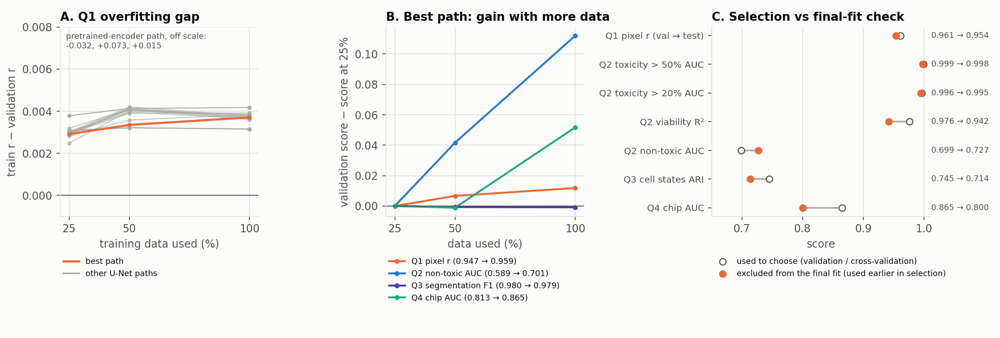

# Summary

Organ-on-a-chip (OoC) experiments are often read out with fluorescent stains such as Cell Painting, an endpoint assay that ends
with fixing the cells, so each sample typically yields a single snapshot instead of the time course it could provide. An end-to-end
system was built that reads bright-field images and was tested on four questions: Q1–Q3 on Cell Painting plates of two cell lines
(A549 and U2OS), not on chips, and Q4 on a separate dataset of OoC microscopy images. Each question was answered by a guided search
over many alternative analysis paths (complete pipelines with one option chosen at each step, §3) with frequentist and Bayesian
statistics, and the winning paths were then replicated on U2OS without re-choosing anything. Table 1 gives the main results;
for Q2–Q4 the same data were used to choose the path and to report its score, so those scores are optimistic (§3).

Table: Main Results of the Four Questions

| Question | Measure | Main study | U2OS replication |
|:-------------|:------------------------------------|:------------------------|:------------------------|
| Q1 Virtual staining | Pixel r, DNA | 0.930 | 0.920 |
| | Pixel r, ER | 0.969 | 0.917 |
| | Pixel r, RNA | 0.977 | 0.953 |
| | Pixel r, AGP | 0.946 | 0.896 |
| | Pixel r, Mito | 0.949 | 0.654 |
| | Nuclei per well, r | 0.991 [0.983, 0.998] | 0.887 [0.822, 0.964] |
| Q2 Drug response | Toxicity AUC, virtual stains | 0.996 [0.993, 0.998] | 0.979 [0.959, 0.993] |
| | Toxicity AUC, bright-field | 0.984 [0.975, 0.991] | 0.933 [0.903, 0.959] |
| | Non-toxic AUC, virtual stains | 0.699 [0.645, 0.749] | 0.482 [0.400, 0.560] |
| | Non-toxic AUC, bright-field | 0.567 [0.512, 0.623] | 0.419 [0.340, 0.500] |
| | Non-toxic AUC, real stains | 0.714 [0.659, 0.764] | 0.516 [0.431, 0.603] |
| Q3 Single cells | Cell F1, virtual vs real | 0.979 [0.978, 0.980] | 0.951 [0.939, 0.962] |
| | Cell-state agreement, ARI | 0.745 | 0.605 |
| Q4 Chip quality | AUC, best path | 0.865 [0.833, 0.893] | — |
| | AUC, baseline | 0.707 [0.654, 0.756] | — |
| | AUC, unseen cell types | 0.853 | — |

*Note.* Main study: for Q1, the A549 test plates, never used for Q1 training or choices; for Q2 and Q3, cross-validation and
agreement on the same plates, which were also used to choose the Q2 and Q3 paths; for Q4, cross-validation over 3,072 chip images
(OoC microscopy images), also used to choose the path. Q4 has no replication because no second publicly available labelled OoC image
dataset could be identified as of October 2026. Pixel r is the mean over test fields of the per-field Pearson correlation, on
held-out compounds; nuclei per well compares virtual and real stains over all wells. Toxicity means a nuclei count more than 20%
below the DMSO wells (a cell-count proxy that cannot separate cell death from slower growth); non-toxic means telling treated from
DMSO wells for compounds that are not toxic by this measure; cell F1 is the agreement between cells segmented on real and on virtual
stains by the same algorithm, not accuracy against human annotations; brackets are 95% confidence intervals. The best paths, all chosen
on the main study, are a U-Net of width 64 with bilinear up-sampling, 2 seeds and test-time augmentation for Q1 (30 paths run), the
best of about 250 paths per feature source and label for Q2 (3,912 paths run), Cellpose cyto3 on all five virtual channels for Q3 (31
segmentation and 65 cell-state paths), and frozen DINOv2 with hand-crafted features and L1 logistic regression for Q4 (1,003 paths);
Table 3 explains why these numbers differ.
For non-toxic drugs, virtual stains outperformed bright-field in the main study (Holm p 0.00023; an exploratory comparison, §3) and no significant difference from
real stains was detected, while in U2OS this subtle effect was not detected on one plate, even with real stains; the toxicity results
replicated (Holm p 0.027).

The final models run as one system (§9): `vcp_system.py` takes bright-field images and OoC images and writes a report with all
four answers, and on a plate and on OoC experiments excluded from their final fit (but used earlier to choose the paths), the Q2
toxicity models keep AUC ≥ 0.995 while Q4 reaches 0.80. Everything runs on public data (JUMP Cell Painting pilot CPJUMP1, CC0, and a Zenodo organ-on-a-chip image set,
CC BY 4.0), and the code, weights, search logs and every per-path score are released.

# 1. Problem and impact

OoC devices recreate tissue interfaces, perfusion and mechanical cues and are increasingly used for preclinical toxicity and
efficacy testing [1], yet their imaging readout often relies on endpoint staining, which ends with fixing the cells, costs reagents and
hands-on time inside microchannels, and can usually be done only once per chip. Bright-field imaging needs neither fixation nor
labels and is available on most OoC microscopes, and deep networks can already predict fluorescent labels from unlabelled images [2], including the Cell Painting
stains [3, 4]. The question addressed here is whether such virtual stains could preserve the information needed to judge whether a drug reduces cell numbers, whether it
changes cells without doing so, what happens to single cells, and whether an OoC image is rated good or bad by experts.

# 2. System overview

Figure 1A shows the system on new images: bright-field fields are turned into five virtual stains (Q1), which feed the
drug-response models (Q2) and the single-cell analysis (Q3), while a separate quality-control model rates an OoC microscopy image
(Q4), and all answers go into one report. Each of the four question boxes (marked with a gear icon) contains a model chosen by its own path search;
Figure 1B zooms into one of them to show that procedure, which is the same for every question (§3).

{width=100%}

*Note.* A: what the deployed system (`vcp_system.py`, §9) runs on new images; real stains, when available, are only shown next to
the virtual ones as a check, and no model uses them. B: inside each gear icon, a path is one complete pipeline, with one option chosen at
each node of the question's tree (Table 3); the search tries many paths on growing shares of the data, and the winning path is
fitted once as the question's final model.

Q2 compares four inputs: real stains, virtual stains (the Q1 winner's output), bright-field only, and bright-field + virtual;
Q3 compares the cells found on real and on virtual stains.
Real and bright-field inputs do not depend on Q1; when the Q1 winner changed, the virtual-input searches of Q2 and Q3 were rerun.

The data come from three public datasets, each analysed as a separate study (Table 2): two cell lines of the JUMP Cell Painting
pilot CPJUMP1 [5] and the organ-on-a-chip image dataset [6].

Table: Datasets, Each a Separate Study

| Dataset | Use | Size |
|---|---|---|
| A549, CPJUMP1 48 h (Cell Painting Gallery cpg0000, CC0) | main study: Q1 trained on BR00117015 (+ BR00117016 in one variant); BR00117017/19 are the Q1 test plates (never used for Q1 training or choices) and the plates on which the Q2 and Q3 paths were chosen and scored | 302 compounds in 320 wells + 64 DMSO wells per plate; 1,152 fields on the training plate (888 training and DMSO, 96 validation, 168 held-out compounds), 1,536 test fields |
| U2OS, CPJUMP1 48 h | replication: the A549 winning paths retrained on BR00117011, tested once on BR00117012 (the only two U2OS 48 h compound plates in which no staining anomalies were found) | 1,152 fields on the training plate, 768 test fields |
| OoC image dataset (Zenodo 10203721, CC BY 4.0) | Q4: training, path selection and evaluation by cross-validation | 3,072 images, 59 experiment groups (from the image-ID prefix), 6 cell types |

Datasets are never options inside a search: each is its own study. 55 of the 302 compounds (18%; a deterministic hash with a 20% target) never enter Q1
training on any plate, so every result can be split into seen vs held-out compounds.

# 3. Method: guided path search and validation

Each question is answered by a search over paths. A path is one complete analysis pipeline, built by choosing one option at each
node of the question's tree: the input data, the processing, the model, its exploration settings and the evaluation metric
(Figure 1B). Table 3 lists the nodes of the four trees, and every option is listed in a config file (`sweep/configs/`). For example,
the winning Q2 viability path is: virtual-stain features → winsorising → z-scores → removal of one channel block → no reduction →
linear SVM, evaluated by R².

Table: Nodes of the Search Tree of Each Question

| Node | Q1 Virtual staining | Q2 Drug response | Q3 Single cells | Q4 Chip quality |
|---|---|---|---|---|
| Input | training plates | feature source (4), label (4) | stain source, channels | all cell types |
| Processing | field cleaning, intensity scaling | cleaning, transform, variable selection, reduction | background subtraction; feature processing | crop, resize, tiles or CLAHE; fusion, reduction |
| Model | U-Net, or U-Net with a pretrained encoder | 16 models, from logistic regression to boosting and MLP | segmentation model; clustering | 9 image representations with 8 classifiers, or a fine-tuned CNN |
| Exploration | width, depth, up-sampling (attention off); inference mode in the final stage | calibration, class imbalance | diameter, thresholds; features, embedding, number of states | trained layers, learning rate (fine-tuning) |
| Evaluation | validation pixel r | AUC (R² for viability) | F1 of virtual vs real masks; ARI of states | AUC |
| Searched tree (combinations) | 72 | 20,736 per stain-source classification search; 250,056 over the 16 searches | 600 segmentation; 576 cell states | 2,304 (+ 24 fine-tuning) |
| Cost of one path (median elapsed time) | ~30 GPU-minutes | ~6 s (one of 4 parallel workers) | ~21 GPU-minutes (segmentation); ~18 s (states) | ~0.2 s (cached embeddings) |
| Budget and time limit | 2 × 20 paths, 6.5 h on 2 GPUs | 250 paths and 1.1 h per search | 4 h (segmentation), 5 h (states), 1.5 h (per-cell classifiers) | 1,000 paths in 9 h; 24 fine-tuning paths in 3 h |
| Proposed / run / completed | 30 / 30 / 17 | 11,294 / 3,912 / 1,584 | 93 / 31 / 9; 340 / 65 / 20; 329 / 49 / 11 | 1,877 / 1,003 / 484 |

*Note.* Q3 is searched in two steps: segmentation first, then the features and cell states on the winning segmentation, plus a
search of per-cell treated-vs-DMSO classifiers. Cross-validation is grouped by compound (Q2), well (Q3) or experiment (Q4). Searched tree: all combinations of the options the search code
actually offered, before the tree's rules; the config files list a few more options that were never run (Q1 attention gates; Q2
Bayesian models, used only in the assessment; Q4 per-cell-type scope, virtual-stain features and a Bayesian logistic classifier).
Cost: median elapsed time from the start of a completed path to its 100% checkpoint, from the search logs.
Proposed: paths suggested by the sampler; run: paths actually evaluated; completed: paths that reached 100% of the data, the
others having been stopped early by the halving rule or, rarely, failed (Q2: 8) or cut by the time limit (Q1: 1). Proposals that
repeated a path or used an excluded option were skipped without running; the Q1 search ran before this skip existed, so 14 of its
30 paths were repeats (15 distinct paths). Q1 also had a final stage of 15 full trainings (7 configurations × 1–3 seeds, §4).

The searched trees contain from 72 (Q1) to about 250,000 (Q2) paths, most of them too costly to run in full (see Search size and
budget below), so one shared engine (`sweep/engine.py`) explores them:

1. Variety first: a balanced warm-up aims to use every option of every node at least 3 times; time limits and rules can cut it
   short (in the Q3 segmentation search, Otsu watershed never ran and StarDist ran once).
2. Guided: the TPE sampler of Optuna [7] proposes the next paths from the results so far.
3. Stages: each path is scored on nested 25% → 50% → 100% subsets of the data; the worse half is stopped at each checkpoint
   (successive halving).
4. Exclusion rule: an option is removed after 4 bad results (stopped at the first checkpoint) in its first 6 uses; the baseline
   option is never removed and every node keeps ≥ 2 options. Every removal is logged.
5. Fixed budget per question (and a time limit), sized for the deadline; repeated proposals are skipped, and a search stops
   when 100 proposals in a row are repeats or excluded.

## Search size and budget

Most searched trees could not be run in full within the time and computing resources available. At the measured cost of one path
(Table 3), running them exhaustively would have needed about 1.5 GPU-days for Q1, about 17 days of one CPU worker for Q2 and about
9 GPU-days for the Q3 segmentation, whereas the work had to fit free Kaggle sessions (two T4 GPUs or four CPU cores; at the time of
the runs, sessions of at most 12 hours and about 30 GPU-hours per week) and the competition deadline; the Q1 search, for example,
had 13 GPU-hours (two GPUs for 6.5 hours). Each search was therefore given a fixed budget of paths and a time limit, and the warm-up,
guided sampling, early stopping and exclusion rule were used to spend that budget on the most promising paths. The number of paths
differs between questions because the cost of one path differs by a factor of about 10,000: a Q1 path trains a U-Net (about 30
GPU-minutes) and a Q3 segmentation path runs Cellpose on all test fields (about 21 GPU-minutes), whereas a Q2 path fits a model on
per-well features in about 6 seconds and a Q4 path fits a classifier on image embeddings that are computed once and cached (about
0.2 s). The procedure is the same for every question; only the budget, set by the cost of a path, differs. The searched Q4 tree is
small enough to have been run exhaustively (2,304 paths, about 7 minutes once the embeddings exist); the guided search was kept so
that all questions follow the same workflow, and an exhaustive Q4 run would be a useful check. These estimates multiply a median
cost by a count of combinations before rules, so they give orders of magnitude, not exact costs.

## Validation: what each score is independent of

Q1 is the only question with a separate test set: its paths and final configuration were chosen on validation fields of the
training plate, and the test plates BR00117017/19 were used once, for the reported Q1 scores. Q2 and Q3 were then searched and
scored on those same plates, so their scores are independent of Q1 training but not of the Q2 and Q3 path choices. Q2 chooses a path
by cross-validation grouped by compound and reports that path's out-of-fold score on the same data; Q3 chooses the segmentation by
real–virtual F1 and the cell-state pipeline by ARI on the fields it reports; Q4 chooses a path by five-fold cross-validation grouped
by experiment over all 59 groups and reports that score. The reported Q2–Q4 scores are therefore subject to selection optimism, and
their confidence intervals do not include the uncertainty of choosing among hundreds of paths. Within each Q2 training fold,
estimator hyperparameters are tuned on inner grouped splits, but the preprocessing (including variable selection and reduction) is
fitted on the whole training fold before those splits, and the choice among paths is not repeated inside the folds, so this is not a
fully nested evaluation of the search; in the Q3 per-cell classifiers, scaling (and PCA where chosen) was fitted on all sampled
cells before the grouped folds. The U2OS replication (§8) has no selection optimism from path choice, since its paths were fixed on
A549.

Bootstrap confidence intervals resample groups (compounds, wells or experiments). DeLong tests treat wells as independent although
compounds repeat across the two plates, and the Holm/BH correction covers only the comparisons reported; these comparisons are
exploratory and conditional on the selected pipelines. Bland–Altman, Lin's CCC and ICC describe agreement.

The Bayesian analyses are secondary checks; paths were chosen with frequentist cross-validation. (i) A Bayesian bootstrap gives the
posterior of the AUC difference between two feature sources: 2,000 draws of flat Dirichlet(1, …, 1) weights over compounds,
summarised as P(difference > 0) and a 95% credible interval. (ii) A Bayesian logistic regression with Gaussian priors, N(0, 1) on
standardised feature weights and N(0, 10²) on the intercept, was fitted to the winning pipeline's features by a Laplace
approximation in Q2, and by MCMC in PyMC (NUTS, 2 chains of 500 draws after 500 tuning steps) on at most 20 principal components of
the four best paths' features in Q4. The posteriors were summarised (credible intervals, predictive standard deviations) but not
plotted or saved as samples, no prior-sensitivity analysis or MCMC convergence diagnostics (R-hat, effective sample size) were kept,
and the hierarchical and horseshoe Bayesian models listed in the Q2 configuration were not run.

## Compute

Kaggle 2×T4 GPU sessions for training and segmentation searches (Q1, Q3, Q4 embeddings, U2OS training) and 4-core CPU
sessions for the first Q2/Q4 searches; test-time inference and the reruns of the Q2 and Q3 model searches ran on a local
workstation (12 CPU cores, 6 GB GPU) with the same code and settings. Searches with a time limit can therefore evaluate a slightly
different number of paths; budgets, rules and data are identical.

# 4. Q1: Virtual staining

## Search

30 A549 paths were run (Figure 2): 17 reached 100% of the data, 11 were stopped early by the halving rule, one stopped
before its first checkpoint, and one (a repeat of the best path) was cut by the time limit; 14 of the 30 repeated an earlier path. The best path (U-Net, width 64, depth 4, bilinear up-sampling) reached validation pixel r
0.9588 vs 0.9549 for the starting model (width 32, transposed convolutions). A pretrained ResNet34 encoder
and log-transformed targets did not improve validation r in this search (attention gates are in the configuration but were not searched). 10 early paths had mixed U2OS plates into training; they
are excluded here because datasets are separate studies (none was among the five best). Overfitting: the train–validation gap of
the best path at 100% data was 0.0037 (pixel r), and validation r still rose from 50% to 100% data.
Search limitation: the sampler proposed already-evaluated paths 14 times; the engine now skips duplicates.



*Note.* Left: each path's validation pixel r at 25%, 50% and 100% of the data; a score below the axis is drawn as ▼ on its edge with its value. A path is stopped only against paths already scored at the same checkpoint, so the second path of the search (the pretrained encoder) reached 100% without competition. Right: the best distinct paths at 100% of the data.

## Final stage

The top 3 distinct paths were trained with 2–3 seeds, the baseline with 3 seeds, and the best path also with a second training
plate and/or focus quality control. The winner is final/t038 (2 seeds) with inference seed_ensemble+tta, all chosen on validation
fields (single_best_seed 0.9586; tta 0.9606; seed_ensemble 0.9601; seed_ensemble+tta 0.9612). The variants a549_focus_qc and
a549_2plates_focus_qc completed only 1 of 2 seeds within the session limit and could not compete (the winner rule requires
≥ 2 seeds); the two-plate variant without quality control did not beat the winner (0.957 vs 0.958).

## Test plates (used once)

Figure 3 shows held-out compounds on the test plates. Pixel r on held-out compounds: DNA 0.930, ER 0.969, RNA 0.977, AGP 0.946,
Mito 0.949. Nuclei per well, virtual vs real: Pearson 0.991 [0.983, 0.998], Lin's CCC 0.991 [0.982, 0.998], ICC 0.991,
Bland–Altman bias -0.56 nuclei (95% limits [-15.4, 14.3]), regression slope 0.993 [0.983, 1.002]. Phenotypic activity (does a
compound's profile retrieve its replicate on the other plate?), mAP: real 0.419 / virtual 0.340 / bright-field 0.196 (held-out
compounds: real 0.339 / virtual 0.312 / bright-field 0.159). The winner improved every stain and the activity mAP over the
starting model (virtual mAP 0.313 → 0.340).



*Note.* For each cell line (A549 top, U2OS bottom): the bright-field input, then the five stains, real (upper row) and virtual (lower row).

## Earlier exploratory experiments

With the starting model, SSIM, gradient and spectrum losses did not measurably change validation r; a GAN made images sharper but cut
activity mAP from 0.313 to 0.257; one bright-field plane instead of three cut it to 0.241. On real chip images, zero-shot virtual
staining was judged, by eye, plausible for only about a quarter of the images.

# 5. Q2: Toxicity and drug response

16 searches (4 feature sources × 4 labels) ran 3,912 paths in total (3,904 scored, 8 failed), which covered cleaning, transformation, variable selection
(correlation filter, mutual information, lasso, stability selection, channel-block removal), reduction (PCA, PLS) and 16 models
(penalised/unpenalised logistic, plate-effect logistic, LDA, naive Bayes, SVMs, kNN, random forest, extra trees, gradient boosting,
XGBoost, MLP, stacking), with calibration and imbalance handling. Nuclei-count features are always removed, because the labels are
built from them: viability is a well's nuclei count relative to the DMSO wells, and toxicity means a viability below 0.5 or 0.8 (more
than 50% or 20% fewer nuclei), a cell-count proxy that cannot separate cell death from slower growth. Figure 4 and Table 4 give the best path per feature source and label.



*Note.* Bars show the out-of-fold score of the best path on the A549 plates, which were also used to choose it (§3); error bars are
95% confidence intervals.

Table: Q2 Cross-Validated Results on the A549 Plates, Best Path per Feature Source [95% CI]

| Label (A549) | Real stains | Virtual stains | Bright-field | Bright-field + virtual |
|---|---|---|---|---|
| Toxicity, > 50% cell loss (AUC) | 0.999 [0.996, 1.000] | 0.999 [0.997, 1.000] | 0.991 [0.984, 0.996] | 0.998 [0.996, 0.999] |
| Toxicity, > 20% cell loss (AUC) | 0.992 [0.987, 0.996] | 0.996 [0.993, 0.998] | 0.984 [0.975, 0.991] | 0.995 [0.991, 0.997] |
| Viability (R²) | 0.980 | 0.976 | 0.913 | 0.977 |
| Non-toxic drugs: treated vs DMSO (AUC) | 0.714 [0.659, 0.764] | 0.699 [0.645, 0.749] | 0.567 [0.512, 0.623] | 0.692 [0.635, 0.742] |

- Cytotoxicity was readily detected: even bright-field reached AUC ≥ 0.98; virtual stains add a small but consistent gain (virtual − bright-field
  +0.012, Holm p 0.012).
- Stains appeared to matter most for drug responses without cell loss (exploratory, §3): virtual − bright-field +0.131 (DeLong p 2.5e-05,
  Holm 0.00023; Bayesian P(virtual > bright-field) = 1.000, 95% CrI [+0.071, +0.190]).
  Virtual vs real: -0.015 (Holm p 1): no significant difference was detected.
- Viability: virtual stains Lin's CCC 0.988 [0.977, 0.997] vs bright-field 0.954 [0.929, 0.974]; Bland–Altman bias -0.003
  [-0.110, 0.104].
- Robustness: leave-one-plate-out AUC (virtual, treated vs DMSO) 0.667/0.727; fixed-score label-shuffle p 0.005 (labels shuffled 200 times against
  the fixed out-of-fold scores, without refitting, re-searching or keeping compounds together, so it checks the score, not the
  search; 0.005 is the smallest possible); a Bayesian logistic model on the same pipeline gives AUC 0.707 [0.652, 0.755].
- Best virtual pipeline (treated vs DMSO): none → zscore → none → none → logistic_l2 → none → class_weights.

# 6. Q3: Single-cell phenotypes

## Segmentation

The segmentation search on the winner's virtual stains ran 31 paths (9 completed; time limit 4 h); the exclusion rule
removed channels=dna_only, seg_model=cellpose_cyto2, diameter=auto and diameter=10. The best path is Cellpose [8] cyto3 on all
five channels (the same path as in the first search), with an F1 (virtual vs real masks, IoU ≥ 0.5) of 0.979; Figure 5 shows it
on one test field. On all 1,536 test fields: F1 0.979 [0.978, 0.980], AP over IoU 0.5–0.95 0.773, Dice of matched cells 0.946;
cells per field Lin's CCC 0.999 [0.999, 0.999], Bland–Altman bias -1.05 (limits [-5.7, 3.6]); median per-cell feature CCC 0.886. These measure agreement between cells segmented on real and on virtual stains by
the same algorithm, not accuracy against human annotations, and the segmentation path was chosen on the same fields.



*Note.* Left: bright-field input. Middle: cells found on the real stains. Right: cells found on the virtual stains.

## Cell states

In the downstream search (65 paths), states were fitted on real cells and virtual cells were assigned by the same model.
The best path, morphology → robust_z_vs_dmso → pca → hierarchical_ward → silhouette, gives 4 states, with real vs virtual
ARI 0.745, NMI 0.629 and bootstrap stability ARI 0.47–0.89 (the states themselves are only moderately stable). Per-cell
treated-vs-DMSO classifiers reach AUC 0.599 on virtual and 0.585 on real stains. With these features, a single cell carried little of the
drug signal with real or virtual stains; the well-level task of Q2 differs (it averages many cells and uses other features), so the
comparison does not show where the signal lies.

# 7. Q4: Organ-on-a-chip quality control

The target is the expert good/bad rating of each OoC microscopy image in the dataset [6]. 1003 paths covered preprocessing (crop,
resize, tiles, CLAHE), 9 representations (hand-crafted, GLCM/LBP texture, ResNet50, EfficientNet-B3, ConvNeXt, DINOv2 [9] S/B/L,
CLIP), fusion with the hand-crafted features, reduction and 8 classifiers, plus 24 fine-tuning paths; virtual-stain features, a
per-cell-type scope and a Bayesian logistic classifier were configured but not run. The exclusion rule removed preprocessing=resize, representation=resnet50, representation=efficientnet_b3,
representation=convnext_tiny, representation=clip_vit_b16, model=random_forest and model=knn. Figure 6 summarises the results.



*Note.* Left: best paths. Middle: AUC on cell types left out of training. Right: calibration of the best path.

- Best: frozen DINOv2-small + hand-crafted features, correlation filter, L1 logistic: AUC 0.865 [0.833, 0.893] vs 0.707
  [0.654, 0.756] (hand-crafted + gradient boosting); Brier 0.147, with good calibration on the reliability plot (Figure 6, right).
- Generalisation: leave-one-cell-type-out AUC 0.853 (baseline 0.658); leave-one-culture-age-out 0.866 (baseline 0.704). The
  culture age is the dataset's 'day' (time after seeding); 12 of the 59 experiment groups span more than one day, so images of one
  group can be in both training and test. Experiment groups are inferred from the leading digits of the image ID, and that they are
  independent experiments was not verified.
- Per cell type: A549 0.829, CACO 0.852, HPMEC 0.859, HSAEC 0.867, HUVEC 0.971, NHBE 0.936. Cell type alone predicts quality at
  AUC 0.569, which suggests that the model does not merely recognise cell types.
- Bayesian check (PyMC logistic regression, §3) on the best path's features: AUC 0.812; its predictive uncertainty did not flag
  errors (mean standard deviation of the logit 0.251 on wrong and 0.264 on right predictions).
- Fine-tuning a CNN (best of 24 paths) reached 0.827: with ~3,000 images, a frozen self-supervised encoder outperformed fine-tuning in this search.

# 8. Replication on a second cell line (U2OS)

The A549 winning paths were applied to U2OS without any new choice: the Q1 winner's settings, seeds (2) and inference mode,
retrained on U2OS plate BR00117011 (validation r 0.880 / 0.895); the Q2 and Q3 winning pipelines on the U2OS test plate
BR00117012. Figure 7 compares the two cell lines.



*Note.* U2OS is a separate study: the A549 winning paths were retrained or applied on U2OS (training plate BR00117011, test plate
BR00117012), with nothing re-chosen.

- Q1: pixel r on held-out compounds DNA 0.920, ER 0.917, RNA 0.953, AGP 0.896, Mito 0.654. Four stains transferred well (0.89–0.95);
  mitochondria did not (in Figure 3 the virtual Mito channel of U2OS is much brighter than the real one). Nuclei per well: Pearson
  0.887 [0.822, 0.964], CCC 0.878 [0.793, 0.963], bias -0.21, slope 1.020 [0.967, 1.074].
- Q2: the toxicity results replicated: toxicity (> 20% cell loss) AUC virtual 0.979 [0.959, 0.993] vs bright-field 0.933 [0.903, 0.959]
  (Holm p 0.027, P(better) 0.998); viability R² virtual 0.935 vs bright-field 0.817. The non-toxic treated-vs-DMSO signal did
  not replicate: real 0.516 [0.431, 0.603], virtual 0.482 [0.400, 0.560], bright-field 0.419 [0.340, 0.500]. With one plate (one
  well per compound) and pipelines chosen on A549, this subtle effect could not be detected, even with real stains.
- Q3: cell F1 0.951 [0.939, 0.962], AP 0.683, count CCC 0.977 [0.945, 0.997], feature CCC 0.799, states ARI 0.605;
  the same ranking as A549 at a lower level.
- Not computed for U2OS: phenotypic-activity mAP and leave-one-plate-out, which both need compound replicates on a second test
  plate.

# 9. The end-to-end system

The searches chose and validated the models; the system puts them together so that new images give all four answers at once,
following the solid arrows of Figure 1. One command runs it:

```
python vcp_system.py --plate BR00117019 --wells B16 B04 A01 --dmso 4 \
                     --chips <photos> --out reports/demo
```

This command streams the wells from the public archive, runs Q1 on the 3 bright-field planes only, then Q2 and Q3 on the virtual
stains and Q4 on the chip photos, and writes an HTML + JSON report. The real stains are downloaded too, but only shown as a check;
no model uses them. The web demo (`apps/web_demo`) runs the same code on one field at a time (Q1–Q3) and on a chip image (Q4).
By default Q1 runs without test-time augmentation on a CPU and with it on a GPU; the reported Q1 scores use the validated mode
(2 seeds + test-time augmentation, which averages the 8 flips and rotations of each field), which `--tta` enables on a CPU
(`vcp_system.py --tta`, `demo.py --tta`; the web demo always runs without it). The final Q2 and Q3 models were fitted and checked on
features from the validated mode, so on a CPU without `--tta` their inputs differ slightly from those they were checked on.

## Final models

Cross-validation measures a path; the deployed model is the same winning path (nothing re-chosen) fitted once
(`tools/fit_final_models.py`, minutes on a CPU, saved in `models/`, ~200 kB). To check the fitted models, each was fitted on part
of the data and checked on the rest (Table 5). These data were excluded from the final fit but had already been used to choose
the paths (§3), so the checks show that refitting the chosen path works; they are not an independent test of the search.

Table: Final Models and Their Checks on Data Excluded From the Final Fit

| Final model (winning path) | Fitted on | Check on data excluded from the final fit (used earlier in path selection) |
|---|---|---|
| Q2 toxicity, > 50% cell loss | plate BR00117017 (320 wells) | plate BR00117019: AUC 0.998 |
| Q2 toxicity, > 20% cell loss | plate BR00117017 | BR00117019: AUC 0.995 |
| Q2 viability | plate BR00117017 | BR00117019: R² 0.942 |
| Q2 non-toxic drug effect vs DMSO | plate BR00117017 (235 wells) | BR00117019: AUC 0.727 |
| Q3 cell states (morphology, robust z vs DMSO, PCA, Ward; 4 states) | real cells of BR00117017 | BR00117019: real vs virtual cells in the same state, ARI 0.714 |
| Q4 chip quality (DINOv2-S + hand-crafted, L1 logistic) | 53 experiments | 6 held-out experiments, one per cell type (554 images): AUC 0.80 |

The cross-validated scores of §4–§7 remain the reported results. On the excluded data, the fitted Q2 and Q3 models stayed close
to their cross-validated level, except for a lower Q2 viability R²; Q4 drops from 0.865 (cross-validated) to 0.80 on the 6 excluded
experiments, and 2 of the 6 random example chips used in the demos, drawn from those experiments, are misjudged. In use, plate BR00117017 plays the role of the calibration set ("stain once"); the per-plate
normalisation of one Q2 pipeline uses the new plate's DMSO control wells (or the calibration plate's when they are missing, as in
the web demo, which sees one field at a time). Speed on a CPU: in a clean-install test on 4 CPU cores, 14 fields and 6 chip images took 251 s without test-time augmentation, about 20 s
per field for Q1–Q3 including the download.

## Not demonstrated

Q1–Q3 were developed on Cell Painting plates, not on OoC devices, and longitudinal virtual staining of living chips was not tested.
Q4 analyses a different input from Q1–Q3, and no public dataset pairing OoC images with Cell Painting stains of the same samples could
be identified as of October 2026. Using Q4 as a quality gate before imaging is a proposed use in a lab, not something tested here.

# 10. Optimisation and overfitting

Every search logs validation scores at each checkpoint, and the Q1 search also logs training scores. Figure 8 summarises three
checks; none of them proves the absence of overfitting. For every U-Net path of Q1 the train–validation gap stayed below 0.005
pixel r at all checkpoints, while the pretrained-encoder path, the weakest one, reached a gap of 0.073 at 50% of the data
(Figure 8A); a small gap on validation fields of the training plate does not rule out overfitting to that plate, which the test
plates check. Validation scores of the best paths of Q1, Q2 and Q4 still rose from 50% to 100% of the data, most of all the subtle Q2
effect (AUC 0.589 → 0.701), so more data might help; for Q1 the 100% checkpoint also trains longer, so data and training effort are
confounded, whereas Q3 segmentation appeared saturated already at 25% (Figure 8B). Scores on data excluded from the final fit stayed
close to the scores used to choose the paths, with the largest drops for Q2 viability (R² 0.976 → 0.942) and Q4 (AUC 0.865 → 0.800),
and a small gain for the Q2 non-toxic effect (Figure 8C); as those data were used for path selection, this is not a test of
selection optimism (§3).



*Note.* A: training minus validation pixel r at each checkpoint for the completed U-Net paths of Q1; the pretrained-encoder path is
off this scale and its values are printed. B: validation score of the best path of each question at 25%, 50% and 100% of the data,
minus its score at 25%, with the scores at 25% and 100% in the legend (Q2: non-toxic drugs vs DMSO on virtual stains; Q3:
segmentation F1; for Q1 the 100% checkpoint also trains for 4,000 steps instead of 2,000). C: the score used to choose each path
(validation for Q1, cross-validation for Q2–Q4) and the score on data excluded from the final fit but used earlier to choose the
path (Table 5); for Q1 the held-out value is the mean test pixel r of the five stains on held-out compounds.

# 11. Limitations and path to organ-on-a-chip use

- Virtual staining was trained on plates. A second cell line needed its own training plate, and even then mitochondria transferred
  poorly; on the real chip images tested, zero-shot staining was not reliable. A calibration set of stained chips would likely be needed
  (no public paired OoC dataset could be identified as of October 2026).
- In these data, cytotoxicity was detected well without stains; the added value of virtual stains appeared for non-lethal
  phenotypes (Q2, A549), which did not replicate on a single U2OS plate.
- Validation: for Q2–Q4 the reported scores come from the same data used to choose the paths (selection optimism); no fully
  nested evaluation of the searches was run, and the Q2 permutation check does not refit or re-search (§3).
- Labels: toxicity and viability are nuclei-count proxies; Q3 compares two algorithmic segmentations, not human annotations; Q4
  predicts expert image ratings, not device performance.
- CPJUMP1 has one dose per compound, so dose–response could not be modelled.
- Search limitations: duplicate proposals in early runs (fixed), time limits on some searches, and a strict exclusion rule that can
  remove middling options.

A possible deployment, not tested here: (1) stain a few calibration chips at the endpoint and fine-tune; (2) image every chip in bright-field (ideally a small
z-stack) every day; (3) run Q2/Q3 readouts on virtual stains and Q4 quality control on the raw image; (4) keep endpoint staining as
a check.

# 12. Reproduction

Table 6 lists the commands that reproduce each part, with the hardware and time they need.

Table: Reproduction Commands

| What | Command | Hardware, time |
|---|---|---|
| Install | `pip install -r requirements.txt` (Python 3.11) | — |
| Model weights | `python weights.py` (GitHub release, checksums verified) | 240 MB |
| Entry script: stain one field live | `python demo.py --compound PP-121` → PNG + nuclei counts + pixel r | CPU, about 25 s; about 55 s with `--tta` (validated mode) |
| End-to-end system | `python vcp_system.py --plate BR00117019 --wells B16 B04 A01 --dmso 4 --chips <photos>` → `report.html` | CPU, about 20 s per field without test-time augmentation |
| Final Q2/Q3/Q4 models | `python tools/fit_final_models.py` (refits the winning paths; needs the raw run outputs) | CPU, minutes |
| Walkthrough notebook | `notebooks/walkthrough.ipynb`: small real runs of Q1–Q4 + all saved results | CPU, under 20 min |
| Web demo (Q1–Q4) | `cd apps/web_demo && python app.py` (Gradio, opens in the browser) | CPU, ~25 s per field (without test-time augmentation) |
| Full Q1 / Q2 / Q3 / Q4 / U2OS | commands in the README; Kaggle notebooks generated by `kaggle_jobs/build.py` | free Kaggle T4 GPUs + CPU; time limits in Table 3 |

## Inputs and outputs

Inputs: CPJUMP1 fields (3 bright-field planes + 5 stains, 16-bit TIFF, streamed from the public S3 archive and packed per
plate by `download.py`); OoC microscopy images (Zenodo). Outputs: virtual stains (5 × 540 × 540 per field), per-field features
(`site_features.csv`), per-cell tables, search logs (`*_paths.csv`, one row per path with its score at each checkpoint) and the
assessment reports (`*_report.json`); `results/` holds all of them except per-cell tables.

## External services

Only free, public ones (Cell Painting Gallery S3, Zenodo, the GitHub release for the weights). Everything runs
on a local machine; without a GPU training is slow, but the demo, the system, the notebook and the assessments run on a CPU. The long
searches were run as Kaggle notebooks (`kaggle_jobs/build.py`), which read intermediate inputs kept private in the team's Kaggle account: they are a
record of how the runs were launched; the local commands are the reproducible path. The repository is designed to rebuild every
reported number, the figures (except the two image examples), the final Q2 models, the system and the demos, and a clean install was
tested for the system and the demos; refitting the final
Q3/Q4 models also needs the per-cell tables and chip embeddings (2 GB), recreated by `q3_search.py features` and `q4_chip_qc.py embed`.

# 13. Team, data, licences and AI disclosure

- Team tmgf: one member, tiagomgfernandes (Kaggle), who also leads the team.
- Code (MIT): https://github.com/tmgf-lab/CCP002-KAGGLE-019-PUB_AI4S_AI-Organ-on-a-Chip. Search configs `sweep/configs/*.yaml`;
  engine `sweep/engine.py`; every path's scores in `results/`.
- Data: CPJUMP1 (cpg0000, CC0) [5], available from the Cell Painting Gallery [10] on the Registry of Open Data on AWS; the AWS
  Open Data Sponsorship Program is thanked for sponsoring the data storage. OoC Image Dataset (Zenodo 10203721, CC BY 4.0) [6],
  used to train, select and evaluate the Q4 models; 8 example images are redistributed as centre crops in `apps/web_demo/examples` with attribution,
  as CC BY 4.0 permits. No personal or clinical data.
- Software and models: PyTorch, segmentation-models-pytorch, timm, Cellpose, scikit-learn, XGBoost, Optuna, statsmodels,
  UMAP, leidenalg (open-source licences). Pretrained weights: ImageNet (ResNet, EfficientNet, ConvNeXt), DINOv2, CLIP, Cellpose.
  Narration voice: Kokoro TTS (Apache-2.0).
- AI assistance: the code, analyses, figures, report and video were built with Claude (Anthropic, via Claude Code), following the team's specifications and decisions, and were reviewed by tiagomgfernandes, who asked for adjustments in later prompts and also edited them directly.

# References

1. Ingber DE. Human organs-on-chips for disease modelling, drug development and personalized medicine. Nat Rev Genet.
   2022;23(8):467–91.
2. Christiansen EM, Yang SJ, Ando DM, Javaherian A, Skibinski G, Lipnick S, et al. In silico labeling: predicting fluorescent
   labels in unlabeled images. Cell. 2018;173(3):792–803.
3. Cross-Zamirski JO, Mouchet E, Williams G, Schönlieb CB, Turkki R, Wang Y. Label-free prediction of cell painting from
   brightfield images. Sci Rep. 2022;12:10001.
4. Bray MA, Singh S, Han H, Davis CT, Borgeson B, Hartland C, et al. Cell Painting, a high-content image-based assay for
   morphological profiling using multiplexed fluorescent dyes. Nat Protoc. 2016;11(9):1757–74.
5. Chandrasekaran SN, Cimini BA, Goodale A, Miller L, Kost-Alimova M, Jamali N, et al. Three million images and morphological
   profiles of cells treated with matched chemical and genetic perturbations. Nat Methods. 2024;21(6):1114–21.
6. Movčana V, Strods A, Narbute K, Rūmnieks F, Rimša R, Mozolevskis G, et al. Organ-on-a-chip (OOC) image dataset for machine
   learning and tissue model evaluation. Data. 2024;9(2):28. doi:10.3390/data9020028. Dataset: Zenodo,
   doi:10.5281/zenodo.10203721.
7. Akiba T, Sano S, Yanase T, Ohta T, Koyama M. Optuna: a next-generation hyperparameter optimization framework. In: Proceedings
   of the 25th ACM SIGKDD International Conference on Knowledge Discovery & Data Mining. New York: ACM; 2019. p. 2623–31.
8. Stringer C, Wang T, Michaelos M, Pachitariu M. Cellpose: a generalist algorithm for cellular segmentation. Nat Methods.
   2021;18(1):100–6.
9. Oquab M, Darcet T, Moutakanni T, Vo H, Szafraniec M, Khalidov V, et al. DINOv2: learning robust visual features without
   supervision. Trans Mach Learn Res. 2024.
10. Weisbart E, Kumar A, Arevalo J, Carpenter AE, Cimini BA, Singh S. Cell Painting Gallery: an open resource for image-based
    profiling. Nat Methods. 2024;21(10):1775–7. doi:10.1038/s41592-024-02399-z.
